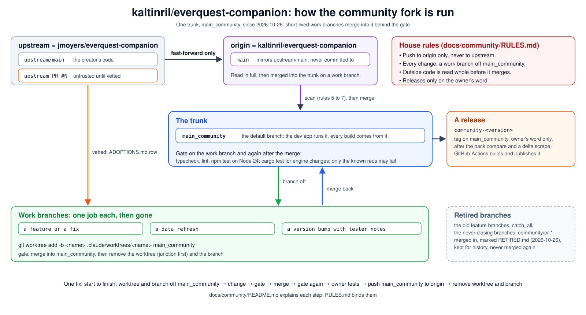

# How the fork is run

This fork (`kaltinril/everquest-companion`, git remote `origin`) started from the creator's repo
(`jmoyers/everquest-companion`, git remote `upstream`). The creator is on hiatus and may not come
back, and other tools now compete for the same players, so since 2026-10-26 the fork runs as its
own project on one trunk, `main_community`, to move fast and change course easily. This directory
holds the rules and records that make that safe.

Read [RULES.md](RULES.md) before touching any branch. [ADOPTIONS.md](ADOPTIONS.md) records every
third-party pull request that was vetted, adopted or deferred. [ISSUES.md](ISSUES.md) records
every upstream issue that was looked at and what became of it. [requirements/](requirements/)
holds each feature area's list of what was asked for (rule 19). [RELEASING.md](RELEASING.md) is
how a test build reaches the fork's Releases page. [BRANCHES.md](BRANCHES.md) is the record of
the retired branches and the list of known test reds. [agent/](agent/INDEX.md) is the working
manual for AI agents.

## How to work in this fork

The same steps for people and agents:

1. **Set up:** Node 24 (Node 22 gives hundreds of false test failures), Rust via rustup, then
   `npm ci`.
2. **Make a work branch and worktree off `main_community`:**
   `git worktree add -b <name> .claude/worktrees/<name> main_community`. Never commit to `main`,
   and never work in the main clone, where the dev app rebuilds on every file that changes.
   Nothing is created beside the repo folder.
3. **Write down the ask first.** A feature's requests go in `requirements/<feature-area>.md`
   before any code. Check every row before changing a feature.
4. **Keep it small.** Change only what the feature needs and match the code around it.
5. **Gate it:** `npm run typecheck`, `npm run lint`, `npm test` (and `cargo test --workspace` in
   `engine/` for an engine change). Only the known reds listed in BRANCHES.md may fail.
6. **Merge it:** close the dev app, merge the work branch into `main_community` from the main
   folder, and run the gate again. Then remove the worktree and the work branch (rule 18).
7. **Push after testing:** once the owner has tried it in the app, push `main_community` to
   `origin`. Never to `upstream`.
8. **Record what you learned.** Rules, procedures and measured facts go in this directory, so
   anyone who clones the repo has them.

## At a glance

The creator's `main` comes down unchanged and, once read, merges into `main_community`. Every
change of ours, and every vetted outside pull request, is a short-lived work branch off
`main_community` that merges back behind the gate and is then removed. A `community-<version>` tag
on `main_community` builds a release. The picture is [fork-workflow.svg](fork-workflow.svg), plain
SVG, so a change to the process is a change to that file in the same commit.

## Why

1. **One trunk is fast.** Until 2026-10-26 every change was its own branch off `main`, kept so it
   could go back to the creator as a pull request, and `main_community` was rebuilt from an
   ordered recipe of about seventy of them. That cost a branch, a recipe line and a merge per fix,
   and conflicts between branches that touched the same files. With the creator gone and handing
   changes back no longer a goal, all of it is retired.
2. **`main` stays the creator's.** It mirrors `upstream/main` and is never committed to, so his
   later changes can still be pulled in with a fast-forward and one merge into `main_community`.
3. **Outside code stays untrusted.** Whatever comes from upstream, his `main` included, is read in
   full before it merges (RULES.md, rules 5 to 8).

## The branches

| Branch | Lifetime | Purpose |
|---|---|---|
| `main_community` | forever | The trunk. Every change lands here; the dev app runs it and every test build and release is cut from it. The fork's default branch on GitHub, so its `.github/README.md` is the front page. |
| `main` | forever | Mirror of `upstream/main`. Never committed to. Pushed to `origin` only, never to `upstream`. |
| work branches | one job | A short-lived branch off `main_community` in its own worktree; merged back, then deleted with its worktree. |
| retired branches | kept | Every other branch, retired on 2026-10-26 with a `RETIRED.md` note: the old feature branches, `catch_all`, `main_community_rules`, `local-data-refresh`, `community_release_rules`, `test-neutering`, the `community/pr-*` copies. Never deleted, never merged again (rule 9). Listed in BRANCHES.md. |

## Procedures

**Sync main.** `git fetch upstream main:main && git push origin main` (the fetch only ever
fast-forwards `main`, and needs no checkout of it). Read the new commits in full (RULES.md, rules 5
to 7), then merge `main` into `main_community` on a work branch, gate, and merge. On a conflict in
`releaseNotes.ts`, take `main`'s wholesale (rule 13).

**See every upstream PR locally.** The `upstream` remote carries a second fetch refspec,
`+refs/pull/*/head:refs/remotes/upstream/pr/*`, so `git fetch upstream` refreshes a read-only
`upstream/pr/N` ref per open PR. `gh pr list --repo jmoyers/everquest-companion` lists them.

**Adopt a third-party PR.** Vet it (RULES.md, rules 5 to 8). Make a work branch off
`main_community` and merge or cherry-pick `upstream/pr/N` onto it. Run the gate there. Add the
ADOPTIONS.md row. Merge into `main_community`, gate again, remove the work branch.

**Merge while the dev app is up.** `npm run dev` runs `electron-vite dev --watch` in this clone,
so every file a merge writes restarts Electron, and a merge burst relaunches the app on a
half-merged tree. Close the app before merging into `main_community`, and make sure the watcher
itself is gone: stopping the shell or task that started `npm run dev` can leave the
`node ... electron-vite.js dev --watch` process running, and it relaunches the app on its own
(2026-10-01). Find it with `Get-CimInstance Win32_Process -Filter "Name='node.exe'"` and a
CommandLine match on `electron-vite`, stop that one process, and its Electron exits with it.
Relaunch after the merges with `node_modules/.vite` cleared.

**Background work while the owner uses the app.** The app's engine must announce itself within
10 seconds of launch. Several parallel typecheck, test or cargo runs pinned the CPU at 100% and
the engine missed that deadline three times (2026-10-01, the "data engine started but never
answered" banner, nothing actually broken). While the owner has the app open, run build and test
work at Idle priority (`(Get-Process -Id <pid>).PriorityClass = 'Idle'` on cargo, rustc and the
test runners) or one job at a time.

**Cut a test build.** Bump the version and write the tester notes as a commit on a work branch
off `main_community`, merge it, then `npm run dist`. Read the previous build's notes first; they
list what the testers caught. The installer is
`release/<version>/everquest-companion-test-Setup-<version>.exe` in this clone, next to the
earlier builds (RULES.md, rule 17). `npm run dist` runs in this clone, never in a worktree (rule
16): a junctioned `node_modules` ships an asar missing dependencies. Before handing a build out,
`npx @electron/asar list release/<version>/win-unpacked/resources/app.asar` must list
`\node_modules\conf`; a build without it fails at launch. A GitHub release is RELEASING.md, on the
owner's word only (rule 10).
